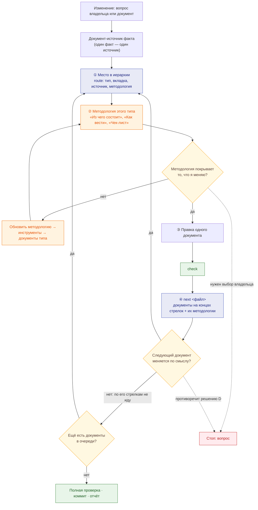

# Путь изменения документа агентом

← [Правила](README.md) · [граф связности](doc-graph.md) · [типы документов](doc-types.md) · [процесс изменения](change-process.md)

## История

**Как** владелец продукта, **я хочу**, чтобы агент менял документацию **по одному документу за раз**: брал методологию именно этого документа, при необходимости сначала обновлял её, правил документ, а затем по графу связности переходил к следующему, **чтобы** изменения не расходились между документами и каждое было сделано по своему правилу, а не массовой правкой.

## Принцип

Изменение — **цепочка документов**, а не пачка правок. В каждый момент агент работает с одним документом:

1. определяет, где документ в иерархии и по какой методологии он ведётся;
2. сверяет методологию с тем, что меняет; если она отстала — сначала обновляет её (а за ней инструменты);
3. правит документ и проверяет;
4. по графу связности находит следующие документы — и берёт **следующий один**.

## ① Где документ в иерархии

| Что узнаю | Откуда | Инструмент |
|---|---|---|
| Тип документа и вкладка | [типы документов](doc-types.md), колонка «Где»; [вкладки](doc-types.md#tabs) — на какой вопрос отвечает и чего на ней нет | `route <файл>` |
| Генерируется ли и что его источник | список генерируемых файлов | `pre <файл>` (хук не даст править генерируемое) |
| Слой и узел графа | [граф связности](doc-graph.md) | `next <файл>` (первая строка — узел) |
| Где живёт факт | [один факт — один источник](change-process.md#single-source) | — |

Цепочка начинается с **самого верхнего документа, который меняется по смыслу**. Если вопрос — про значение параметра, начало — таблица параметров спеки, а не задача или Deploy.

## ② Методология документа

Читаю методологию **только этого типа** — ссылку даёт `route`. Правила целиком не читаю.

Методологию обновляю **до правки документа**, если:

- она молчит о том, что я меняю (раздел, связь, вид данных);
- она ссылается на то, чего уже нет (вкладку, страницу, файл);
- документ правильный, а методология требует другого (значит, отстала она).

У методологии своя цепочка: сначала **инструменты** (проверки, навыки, хуки), затем **документы этого типа** — привести к новой методологии ([изменение правил](change-process.md#rules-change)).

## ③ Правка и проверка

Правлю один документ. После правки хук редактора (если есть) показывает выжимку правил и следующие документы. `check` за секунды проверяет трассировку, коды, модели, ссылки и соответствие инструментов правилам.

## ④ Следующий документ

`next <файл>` выдаёт документы на концах стрелок графа: что в каждом проверить и по какой методологии он ведётся. Беру их **по одному** и повторяю цикл. Если следующий документ по смыслу не меняется (например, задача, объём которой не изменился), его стрелки дальше не прохожу — на этой ветке цепочка закончилась.

## Где останавливаюсь

| Ситуация | Что делаю |
|---|---|
| Очередь пуста, проверки чистые | цепочка закрыта → коммит и отчёт: какие документы изменены, в каком порядке, какие методологии обновлены |
| Нужен выбор продукта; изменение противоречит принятому решению D; удаление; новая вкладка | **стоп, вопрос владельцу**; ниже по цепочке ничего не меняю до ответа |
| Факт неизвестен | не придумываю: код, спецификация API, решения; нет — открытый вопрос в спеке |
| Документ выше по иерархии противоречит изменению | цепочка начинается с него |
| Расхождение вне цепочки | не правлю молча: строка в [журнале отклонений](deviations.md) или в таблице расхождений |
| Исправлений много (проверка ролями, ревью, смена методологии) | не по одному: [массовые изменения](change-process.md#bulk) |
| Документ переименован или перенесён | не цепочка: файл и все ссылки на него — сразу одним шагом ([правило](change-process.md#links)) |
| Новый документ | входящая ссылка от родителя, навигации или индекса типа; дальше — по графу |

## Пример: «срок хранения записей — 90 дней после закрытия задачи»

| # | Документ | Методология | Правка | `next` дал |
|---|---|---|---|---|
| 0 | вопрос про значение → источник: параметр `retention` в спеке компонента | — | проверка вверх: решения и R&D срок не задают → решение не меняется, вопрос владельцу не нужен | — |
| 1 | параметры спеки компонента-владельца, `retention` | [SDD](sdd.md), [критерии](spec-criteria.md) | значение и обоснование | Интеграции и Данные, «Как работает», Deploy, задачи |
| 2 | параметры спеки компонента, где параметр настраивается | та же | то же значение | те же узлы — уже в очереди |
| 3 | файл данных: политика таблицы | [данные](data.md) | срок и очистка | «Как работает», задачи |
| 4 | «Как работает» компонента | [архитектура](architecture.md) | срок в шагах не упоминается → не меняется, дальше не иду | — |
| 5 | Deploy компонента | [Deploy](deploy.md) | значение в примере конфигурации | — |
| 6 | задача компонента | [задачи](tasks.md) | подзадача очистки — если её нет | Roadmap, сводная таблица |
| 7 | Roadmap и сводки | [задачи](tasks.md) | итоги, если изменилась оценка | — |
| — | конец | | полная проверка, коммит | |

Если бы срок был зафиксирован в решении D, цепочка начиналась бы с решений и останавливалась на вопросе владельцу до любой правки ниже.

## Инструменты, которые ведут по этому пути

| Что | Команда |
|---|---|
| Место и методология документа | `route <файл>` |
| Следующие документы и их методологии | `next <файл>` |
| Подсказка после каждой правки | хук после правки: выжимка + следующие документы + замечания проверок |
| Запрет правки генерируемого | хук до правки (`pre`) |
| Проверки | `check`; перед коммитом — git-хук (`staged`) |
| Инструменты соответствуют правилам | `check` включает проверку: методологии из таблицы существуют, `route` узнаёт типы, у узлов графа есть файлы |

Контракт команд — [tools/README.md](../tools/README.md).
