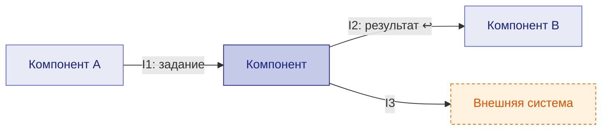

# Формат схем и архитектурных ответов

← [Правила](README.md) · [архитектура](architecture.md)

Коротко. Максимум информации в схеме, минимум текста. Схемы **рисуются** (mermaid): в предпросмотре Markdown и на сайте — сами; из ответа или черновика — командой `diagram <файл>` (HTML-страница с отрисованными схемами).

## Какие схемы и как рисовать

Одна схема — один уровень (C4). Если у схемы есть источник данных (файл данных компонентов, интеграций, историй), она генерируется, а не рисуется руками.

| Вид | На какой вопрос отвечает | Mermaid | Правила |
|---|---|---|---|
| **C1** — компонент и соседи | с кем связан компонент и кто кого вызывает | `flowchart LR` | компонент в центре (`self`), соседи — `comp`, внешние системы — `ext` (оранжевый пунктир); стрелка — **кто вызывает**; подпись — I-коды, `↩` — данные в ответе; общая инфраструктура — пунктир без стрелки |
| **C2** — система | из каких компонентов и хранилищ состоит | `flowchart TB` + `subgraph` на зону | компоненты — прямоугольники, хранилища — цилиндры `[(…)]`, люди — `([…])`; встроенный компонент — внутри подграфа хоста; стрелка подписана данными и I-кодом |
| **C3** — устройство компонента | из каких блоков состоит компонент | `flowchart TB` | ряд блоков — один уровень; зона — подграф; одна подписанная стрелка между рядами; цвет — статус (зелёный есть, жёлтый частично, серый не начато), соседний компонент — оранжевый пунктир, бэклог — бледный |
| **Sequence** — порядок работы, сценарий | что за чем происходит между участниками | `sequenceDiagram` | участники слева направо — в порядке пути работы, люди — `actor`; сообщение — вызов (`POST /path`) или модель и I-код; ответ — пунктир `-->>`; ошибки — `alt` / `else`; ожидание и повтор — `loop` / `Note`; авторизация — один раз в `Note`; до ~12 сообщений, больше — разбить на сценарии |
| **Развёртывание** | где что работает | `flowchart TB` + `subgraph` на узел / namespace | образы, порты, сеть; значения лимитов — ссылкой на параметры спеки |
| **ER** — данные | что хранится и как связано | `erDiagram` | генерируется из файла данных; таблицы другого домена — одним ключом |

**Общее для всех:** подписи на языке документации, коды и имена — как в коде; цвета — единые классы (`self`, `comp`, `ext`, `store`, `user`, `done` / `part` / `todo`); изменённое в предложении — класс `new` (пунктир) и пометка в подписи.

Пример C1:



## Ответ по архитектуре <a id="answer"></a>

1. **Схема** нужного вида из таблицы выше — блок ` ```mermaid `; для просмотра — `diagram <файл>`.
2. **Блоки** — таблица: блок | задача | нужен? (почему).
3. **Расширения** — та же схема, новое — классом `new`: что добавляем → куда → кто подхватывает.
4. **Плюсы / минусы — по каждому модулю**, не по схеме в целом.
5. **Куда внесена правка** — файл и раздел.

ASCII-рамки (`┌─┐`) — только там, где mermaid не рисуется (комментарии в коде, консоль).
