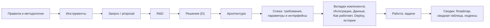

# Граф связности документов

← [Правила](README.md) · [путь изменения](agent-workflow.md) · [процесс изменения](change-process.md)

Изменение в документе слева требует проверить документы справа по стрелкам. В проекте граф хранится в одном источнике (файл данных графа: узлы, шаблоны путей узлов, связи с подсказкой «что проверить»), по нему работает `doc next` и рисуется схема.

## Слои

Порядок слоёв: **правила → запрос → решение → архитектура → спека → вкладки → работа → сводки**. Изменение начинается с самого верхнего слоя, который меняется по смыслу.

## Связи (основа для адаптации)

| От | К | Что проверить |
|---|---|---|
| Методология | инструменты; документы этого типа | выжимка `route` показывает новое правило; документы приведены или расхождения записаны |
| R&D | решения | у выбора есть D-номер; последствия Э10 внесены |
| Решения | архитектура, спеки, файл данных, задачи | нет текста, противоречащего решению |
| Архитектура | страницы компонентов, схемы спек | компоненты и связи совпадают |
| Требование спеки | «Как работает», истории, задачи, трассировка | у требования есть сценарии, история, задача |
| Параметры и интерфейсы спеки | файл данных (интеграции, хранилища), Deploy («Конфигурация»), «Как работает», спеки-участники | значение в одном месте; связь описана с обеих сторон |
| Файл данных (интеграции, модели, таблицы) | каталог API, примеры, спеки-участники | примеры = поля моделей; I-коды совпадают |
| User Stories | спека, трассировка, задачи | у истории есть требование |
| Задача | Roadmap, сводная таблица, индексы | итоги и ссылки совпадают |

## Как пользоваться

1. Найдите узел документа, который меняете: `next <файл>` выдаёт узел и документы на концах стрелок.
2. Правьте следующий документ только после того, как закончили текущий: его методология → правка → `check`.
3. У каждого следующего документа снова `next` — пока стрелки не приведут к документам, которые не изменились по смыслу.
4. Изменилась методология — первая стрелка ведёт к инструментам: сначала они, потом документы.
5. Новый тип документа — новый узел и связи в графе.
