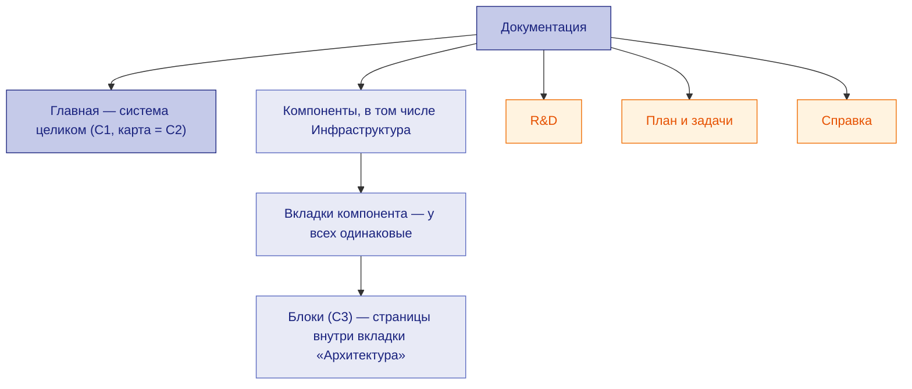

# Структура документации

← [Правила](README.md) · [типы документов и вкладки](doc-types.md) · [путь изменения](agent-workflow.md)

Отвечает на вопрос **«где лежит документ, откуда он берётся и по какой методологии ведётся»**. Читатель — тот, кто добавляет компонент, вкладку или раздел, и агент, который определяет место документа в иерархии. Что именно пишется во вкладке и чего в ней быть не должно — в [таблице вкладок](doc-types.md#tabs).

## Уровни

| Уровень | Что это | Правило |
|---|---|---|
| Главная | система целиком: C1, карта (C2), взаимодействие компонентов, развёртывание, сквозные решения | только то, что не принадлежит одному компоненту ([архитектура](architecture.md)) |
| Компонент | единица ответственности (C2); у каждого — **один и тот же набор вкладок** | [тип сущности](architecture.md#entity) |
| Встроенный компонент | компонент, работающий внутри другого (хоста), — **такие же вкладки**, как у компонента | [связность](architecture.md#connectivity) |
| Инфраструктура | **компонент**, а не отдельный раздел: кластер, вход, хранилища, бэкапы | как у компонента |
| Блок | часть компонента (C3), страница внутри вкладки «Архитектура», без своих вкладок | [блоки](blocks.md) |
| Общие разделы | R&D, План и задачи, Справка — сквозные списки и правила | ниже |

## Вкладки компонента и откуда они формируются

Колонку «Источник» проект заполняет своими путями. Если страница собирается из файла данных (таблицы компонентов, блоков, интеграций, моделей), она **генерируется** и руками не правится — правится источник.

| Вкладка | Отвечает на вопрос | Источник (пример) | Генерируется | Методология |
|---|---|---|---|---|
| Архитектура | из чего состоит, почему так, как работает | файл данных компонентов и блоков, `how/<компонент>.md` | да (кроме «Как работает») | [архитектура](architecture.md), [блоки](blocks.md) |
| User Stories | кто и зачем пользуется, как проходит процесс | файл историй | да | [User Stories](user-stories.md) |
| Спеки | что компонент обязан делать | `spec.md`, параметры и интерфейсы спеки, трассировка, вопросы, подтверждения | список — да, спеки — нет | [SDD](sdd.md), [критерии](spec-criteria.md) |
| Задачи | что сделать, сколько стоит, как принять | документы задач | список — да | [задачи](tasks.md) |
| Интеграции | с кем связан, что передаётся, какие вызовы | файл данных интеграций и моделей + каталог эндпоинтов | частично | [API](api.md), [данные](data.md) |
| Данные | что компонент хранит и как | файл данных таблиц, схема БД | да | [данные](data.md) |
| Deploy | как собрать, развернуть, настроить | `deploy/<компонент>.md` + «Конфигурация» из параметров спеки | частично | [Deploy](deploy.md) |
| R&D | почему выбрано так | документы R&D | список — да | [R&D](rnd.md) |
| Замечания | что нашли роли и как закрыто | файл замечаний компонента | нет | [ревью](review.md#findings) |

## Общие разделы

| Раздел | Страницы | Методология |
|---|---|---|
| R&D | реестр R&D, R&D по компонентам, сводка последствий, решения | [R&D](rnd.md), [решения](decisions.md) |
| План и задачи | Roadmap, сводная таблица задач, задачи по компонентам, бэклог, технологии, план документации, подтверждения документов, ревью | [задачи](tasks.md), [подтверждения](approvals.md), [ревью](review.md) |
| Справка | **только общее**: правила, методологии, формат схем, персоны, промпты ролей, журнал отклонений | эта методология |

Отдельных общих разделов «Архитектура» и «Требования» нет: обзор архитектуры — на главной, требования, истории, API, данные — во вкладках компонентов.

## Сопровождающие страницы
Отвечают на вопрос **«где что лежит, с чего начать, на чём построено»**. Основа — [Diátaxis](https://diataxis.fr) (объяснение, справочник и инструкция раздельно), [технологический радар](https://www.thoughtworks.com/radar), docs as code.

| Страница | Что в ней |
|---|---|
| README | вход в репозиторий: что за система, ссылки на разделы |
| Справка | только общие страницы; ничего про данные конкретных компонентов |
| План документации | этапы работ над документацией со статусом ✅ / ⏳; «✅» — только с проверяемым результатом |
| Технологии | технология, назначение, версия, лицензия, источник, кольцо радара (Adopt / Trial / Assess / Hold), ссылка на R&D |
| Бэклог | что отложено, почему, условие возврата, требование |
| Навигация, индексы | меню и списки по компонентам — генерируются |

## Как вести

| Когда | Шаги |
|---|---|
| Новый компонент | все вкладки сразу; проверка: полный набор документов компонента |
| Новая вкладка компонента | решение владельца → строка в таблицах здесь и в [doc-types](doc-types.md#tabs) → навигация → у всех компонентов |
| Новая страница общего раздела | строка в таблице раздела (источник и методология) → навигация |
| Изменилось место или источник страницы | сначала эта методология, затем инструменты ([изменение правил](change-process.md#rules-change)) |

## Чек-лист

- [ ] У каждого компонента, в том числе встроенного и Инфраструктуры, все вкладки.
- [ ] У каждой страницы общего раздела назван источник и методология.
- [ ] Блок — не вкладка, а страница внутри «Архитектуры».
- [ ] Каждая страница меню покрыта типом документа; в «Справке» нет страниц про конкретные компоненты.

## Проверки

Вкладки в навигации = таблица «Вкладки компонента»; у каждого компонента полный набор документов; страниц вне меню нет.
